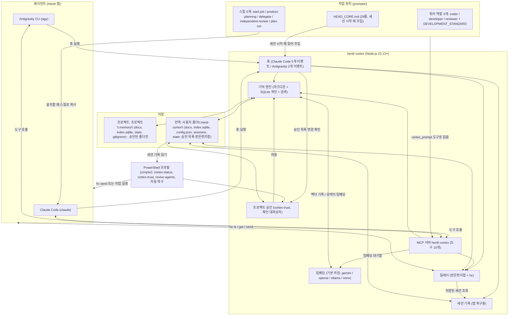

# herdr-cortex

Windows 11의 **Herdr**(탭마다 에이전트를 띄우는 터미널 앱이며, 명령줄 도구는 `hc`) 환경에서 **Claude Code**(`claude`)와 **Antigravity CLI**(`agy`)가 함께 쓰는 장기 기억·복구 도구이며, 에이전트를 여러 탭에 띄워 두고 긴 작업을 이어 가는 사람을 위한 것입니다. 에이전트의 대화는 압축, `/clear`, 재시작, PC 재부팅을 거치면 앞의 맥락을 잃습니다. herdr-cortex는 합의한 결정과 할 일을 대화 밖의 마크다운 파일로 저장해 두고, 세션이 다시 시작될 때 그 요약과 직전 대화를 자동으로 다시 넣어 줍니다. 여기에 탭 사이의 메시지 전달, 재부팅 뒤 탭 복구, 메인 대화가 따르는 작업 원칙(프롬프트)이 더해져 있습니다.

이 문서에서 자주 쓰는 말은 다음과 같습니다.

- **기억 문서**: 결정·작업 기록·지식·할 일·기준선 하나를 담은 마크다운 파일 하나입니다.
- **프로젝트 계층 / 전역 계층**: 기억 문서를 두는 두 곳입니다. 프로젝트 계층은 프로젝트 폴더 안의 `.memory\`, 전역 계층은 사용자 폴더의 `%USERPROFILE%\.herdr-cortex\`(이하 "전역 저장소")입니다.
- **훅**: Claude Code와 Antigravity CLI가 세션 시작 같은 시점에 실행해 주는 외부 명령입니다. herdr-cortex는 이 공식 훅으로만 대화에 내용을 넣습니다.
- **MCP 서버**: 에이전트에게 도구를 제공하는 프로그램입니다. herdr-cortex는 `herdr-cortex`라는 이름의 서버로 도구 10개를 제공합니다.
- **HEAD / 서브에이전트**: HEAD는 사용자와 직접 대화하는 메인 대화, 서브에이전트는 HEAD가 띄운 하위 에이전트입니다.

---

## 한눈에 보기

| 영역 | 하는 일 |
| :--- | :--- |
| **기억 문서** | 문서 하나가 파일 하나인 마크다운을 프로젝트 계층과 전역 계층에 저장합니다. 검색용 색인(SQLite)은 이 파일들로부터 만든 캐시입니다. |
| **프로젝트 승인** | 사용자가 승인한 폴더의 `.memory\`만 읽고 쓰고 대화에 넣습니다. 승인은 확인 대화상자를 거칩니다. |
| **검색** | 메타데이터 필터, 한국어에 맞춘 키워드 검색, (켰을 때) 벡터 검색, 문서 사이의 연결을 합쳐 순위를 매깁니다. |
| **임베딩** | 기본값은 꺼짐입니다. 켜면 `gemini`, `openai`, `ollama`, `onnx` 중 하나로 문서를 벡터로 바꿉니다. |
| **훅** | 세션 시작·압축·`/clear` 뒤에 원칙, 기억 요약, 받은 메시지, 직전 대화(최대 5턴)를 글자 수 예산 안에서 다시 넣습니다. |
| **탭 릴레이** | 같은 PC의 다른 Herdr 탭으로 메시지를 보내고, 쉬고 있는 탭을 한 줄로 깨웁니다. |
| **탭 복구** | 재부팅 뒤 빈 셸로 다시 열린 탭에서 원래 대화를 이어 엽니다. |
| **작업 원칙(프롬프트)** | 29줄 원칙 `HEAD_CORE.md`, 스킬 5개, 워커 역할 3개를 제공합니다. |

---

## 설치와 제거

### 요구 사항

- **Windows 11**과 PowerShell(Windows PowerShell 5.1 또는 PowerShell 7 이상)
- **Node.js 22.13.0 이상**. 내장 SQLite 모듈(`node:sqlite`)을 씁니다. 설치 스크립트가 버전을 확인하고, 낮으면 아무것도 바꾸지 않고 끝납니다.
- **Claude Code**. Antigravity CLI는 있으면 함께 설정됩니다.
- **Herdr의 `hc.exe`**(선택). 탭 릴레이와 탭 복구에만 필요하며 PATH에 있어야 합니다. 없으면 설치 중 경고만 나옵니다.

### 설치

```powershell
git clone https://github.com/ggumtakg/herdr-cortex.git
cd herdr-cortex
npm install
powershell -ExecutionPolicy Bypass -File .\install.ps1
```

`npm install`은 벡터 검색에 쓰는 `sqlite-vec` 패키지 하나를 받습니다. 받지 않아도 설치는 되지만 벡터 검색은 꺼집니다. 실행하기 전에 알아 둘 것은 다음과 같습니다.

- **먼저 검사하고, 바꾸기 전에 백업합니다.** `install.ps1`은 바꿀 파일을 모두 읽어 검사하고, 문제가 하나라도 있으면 아무것도 바꾸지 않고 종료 코드 1로 끝납니다. 기존 파일을 바꿀 때는 먼저 `<파일>.herdr-cortex.<연월일-시분초>.bak`으로 복사합니다.
- **훅과 MCP 서버를 등록합니다.** `~\.claude\settings.json`에 훅 5개를, `~\.claude.json`에 MCP 서버 `herdr-cortex`를, `~\.claude\skills\cortex-*`에 스킬 5개를 넣습니다. Antigravity 쪽 설정(`~\.gemini\`)은 `agy`가 PATH에 있거나 그 폴더가 이미 있을 때만 건드립니다. 사용자가 등록한 다른 훅과 설정은 그대로 둡니다.
- **PowerShell 실행 정책을 묻습니다.** 현재 정책으로는 PowerShell 프로필이 불러와지지 않을 때만 `Set the ExecutionPolicy of the current user to RemoteSigned? [Y/N]`이라고 묻고, `y`나 `yes`라고 답해야 현재 사용자 범위의 정책을 `RemoteSigned`로 바꿉니다(이전 값은 기록해 두었다가 제거할 때 되돌립니다). 바꾸지 않으면 아래의 셸 명령과 자동 탭 복구는 쓸 수 없고, 훅과 MCP 서버는 그대로 동작합니다. 프로필에는 표시로 둘러싼 블록 하나만 넣습니다.
- **Claude Code와 Antigravity 탭을 다시 시작해야 합니다.** 훅과 MCP 서버는 새로 시작한 세션부터 적용됩니다.
- **프로젝트 폴더마다 승인해야 합니다.** 기억을 쓸 프로젝트 폴더에서 `cortex-trust approve`를 한 번 실행합니다. 확인 대화상자에서 "예"를 눌러야 승인되며, 승인하기 전에는 그 폴더의 기억을 읽지도 쓰지도 않습니다([프로젝트 승인](src/core/README.md#3-프로젝트-승인-trustmjs-trust-climjs-confirmmjs)).
- **임베딩은 기본값이 꺼짐입니다.** 사용자가 프로바이더를 고르기 전에는 문서도 검색어도 이 PC 밖으로 나가지 않습니다([임베딩 설정](src/embeddings/README.md#설정)).

설치가 묻는 것과 바꾸는 것의 전체 표, 스위치 네 개(`-NoAutoResume`, `-SetExecutionPolicy`, `-SkipExecutionPolicy`, `-NodePath`)는 [`scripts/README.md`의 "설치와 제거"](scripts/README.md#설치와-제거)에 있습니다.

### 제거

```powershell
powershell -ExecutionPolicy Bypass -File .\uninstall.ps1
```

제거는 설치가 등록한 것(훅, MCP 항목, 스킬 폴더, 프로필 블록)만 지우고, 설치가 바꾼 실행 정책을 되돌린 뒤, 끝에 남아 있는 것을 출력합니다. 백업 파일은 `-RemoveBackups`, 전역 저장소는 `-PurgeData`를 붙여야 지워지며, 각 프로젝트의 `.memory\` 폴더는 사용자의 데이터이므로 어떤 스위치로도 지우지 않습니다([제거의 세부](scripts/README.md#제거-uninstallps1)).

---

## 셸 명령

실행 정책이 프로필을 막지 않는다면, 설치한 뒤 새 PowerShell 창에서 아래 명령을 어느 폴더에서나 쓸 수 있습니다.

| 명령 | 하는 일 |
| :--- | :--- |
| `cortex-status` | Node 경로, 훅과 MCP 등록, 현재 폴더의 승인·제외 여부, 임베딩이 어디로 보내는지와 포기한 문서, 색인 상태(미색인 문서, 중복 ID), 받은편지함, 설정 문제를 한 화면에 보여 줍니다. 고칠 것이 있으면 `Needs attention` 아래에 나열합니다. |
| `cortex-trust approve [폴더]` | 폴더 하나를 승인합니다(확인 대화상자). |
| `cortex-trust revoke [폴더]` | 승인을 거둡니다. |
| `cortex-trust status [폴더]` | 승인 여부를 보여 줍니다. 종료 코드는 승인됨 0, 승인 안 됨 1입니다. |
| `cortex-trust list` | 승인된 폴더를 모두 보여 줍니다. |
| `cortex-trust acknowledge` | 대화상자를 거치지 않고 바뀐 승인 목록을 확인하고 받아들입니다. |
| `revive-agents` | 빈 셸이 된 에이전트 탭을 모두 복구합니다. `-DryRun`을 붙이면 무엇을 할지만 보여 줍니다. |
| `revive-status` | 살아 있는 탭과 탭별로 저장된 세션을 보여 줍니다. |

`cortex-trust`에 폴더를 주지 않으면 현재 폴더가 대상입니다. 명령별 출력과 판정 규칙은 [`scripts/README.md`](scripts/README.md#셸-명령)에 있습니다.

---

## 구성



훅은 임베딩을 하지 않습니다. 벡터는 MCP 서버 안의 대기열(또는 `npm run embed`)이 만들고, 검색은 검색어를 임베딩할 때만 프로바이더를 부릅니다.

---

## 어디에 무엇이 있나

기능의 동작, 설정, 도구의 인자와 오류 코드, 한계는 그것을 구현하는 폴더의 README에 있습니다.

| 폴더 | 문서 | 그 문서가 다루는 것 |
| :--- | :---: | :--- |
| `src/core/` | [README](src/core/README.md) | [저장 위치와 전역 저장소의 구조, 환경변수](src/core/README.md#1-경로와-전역-저장소-configmjs), [설정 레퍼런스와 프로젝트 제외](src/core/README.md#2-설정-configmjs), [프로젝트 승인과 확인 대화상자](src/core/README.md#3-프로젝트-승인-trustmjs-trust-climjs-confirmmjs), [기억 문서의 형식과 인코딩](src/core/README.md#4-문서-형식-frontmattermjs-encodingmjs), [색인과 미루기](src/core/README.md#5-색인-db-dbmjs), [저장·갱신·대체](src/core/README.md#6-저장소-storemjs), [검색](src/core/README.md#7-검색-searchmjs), [연결 탐색](src/core/README.md#8-그래프-graphmjs), [주입 예산](src/core/README.md#9-주입-분량과-주입-표시-budgetmjs) |
| `src/embeddings/` | [README](src/embeddings/README.md) | [임베딩 설정](src/embeddings/README.md#설정), [프로바이더 4종과 무엇이 어디로 전송되는가](src/embeddings/README.md#프로바이더), 문서 대기열, [차단기와 포기한 문서](src/embeddings/README.md#장애-대응), [`npm run embed`](src/embeddings/README.md#cli-npm-run-embed) |
| `src/mcp/` | [README](src/mcp/README.md) | MCP 서버와 [기억·프롬프트 도구 7개의 인자와 결과](src/mcp/README.md#도구-7종), [결과에 붙는 표시와 제외·미승인일 때의 응답](src/mcp/README.md#도구-호출의-공통-규칙-toolsmjs), [오류 코드](src/mcp/README.md#오류-코드), [서버 옵션](src/mcp/README.md#직접-실행-옵션과-환경변수) |
| `src/hooks/` | [README](src/hooks/README.md) | [등록되는 훅](src/hooks/README.md#등록되는-훅), [세션 시작·압축·`/clear` 뒤의 주입과 직전 대화 복원](src/hooks/README.md#claude-code-처리기-claudemjs), [도구 호출 전 검사](src/hooks/README.md#pretooluse-도구-호출-직전의-검사), [Antigravity에서 다른 점](src/hooks/README.md#antigravity-처리기-antigravitymjs), [설치기의 내부](src/hooks/README.md#설치기-installermjs) |
| `src/relay/` | [README](src/relay/README.md) | [탭 릴레이의 흐름](src/relay/README.md#전체-흐름), `hc` 호출, 받은편지함, 릴레이 도구 3개와 [깨우기 결정표](src/relay/README.md#깨우기-결정표) |
| `src/revive/` | [README](src/revive/README.md) | 탭별 세션 기록의 형식과 기록 규칙 |
| `prompts/` | [README](prompts/README.md) | [설계 원리](prompts/README.md#설계-원리), `HEAD_CORE.md`, 개발 기준, 스킬 5개, 워커 역할 3개, [`plan-run`의 기준선 규약](prompts/README.md#plan-run의-기준선-규약) |
| `scripts/` | [README](scripts/README.md) | [설치와 제거의 전 과정](scripts/README.md#설치와-제거), [셸 명령과 `cortex-status`의 출력](scripts/README.md#셸-명령), [탭 복구의 판정 규칙](scripts/README.md#탭-복구), 설치 보조 함수 |
| `test/` | [README](test/README.md) | 자동 테스트 18개 파일(182개)의 [구성](test/README.md#테스트-스위트-구성), 실제 홈 격리, [실물과 대역](test/README.md#실물과-대역). `npm test`로 실행합니다. |

루트에는 [`install.ps1`](install.ps1)과 [`uninstall.ps1`](uninstall.ps1)이 있습니다.

---

## 확인 상태와 알려진 한계

자동 테스트는 가짜 `hc`, 가짜 임베딩 서버, 가짜 `claude` 명령, 격리된 홈 폴더를 씁니다. 실제 환경(Windows 11, Node 26.13.1, `hc` 0.1.21, Claude Code 2.1.330이 설치된 개발 PC 한 대)에서 직접 본 것과 그렇지 못한 것은 모듈마다 그 README의 "확인 상태" 절에 구분해 적었습니다: [core](src/core/README.md#확인-상태), [embeddings](src/embeddings/README.md#확인-상태), [mcp](src/mcp/README.md#확인-상태), [hooks](src/hooks/README.md#확인-상태), [relay](src/relay/README.md#확인-상태), [scripts](scripts/README.md#확인-상태), [test](test/README.md#확인-상태).

### 확인하지 못한 것

아래 항목은 실제 환경에서 확인하지 못했습니다. 연결된 곳에 항목마다 무엇을, 왜 못 했는지, 지금의 근거, 확인 방법, 가정이 틀렸을 때의 증상을 적었습니다.

| 항목 | 자세한 곳 |
| :--- | :--- |
| 이 형식의 훅을 지원하는 가장 낮은 Claude Code 버전 | [hooks](src/hooks/README.md#이-형식의-훅을-지원하는-가장-낮은-claude-code-버전) |
| 실제 `claude mcp remove`의 동작 | [hooks](src/hooks/README.md#실제-claude-mcp-remove의-동작) |
| 실행 정책을 묻는 화면, 제거할 때의 복원, 이미 있는 프로필에 대한 동작 | [scripts](scripts/README.md#실행-정책을-묻는-화면-제거할-때의-복원-이미-있는-프로필에-대한-동작) |
| `PreToolUse`의 "사용자에게 확인"이 MCP 도구 호출에도 적용되는지 | [hooks](src/hooks/README.md#pretooluse의-사용자에게-확인이-mcp-도구-호출에도-적용되는지) |
| `PreToolUse`의 대상 지정이 도구 이름 전체와 맞춰지는지 | [hooks](src/hooks/README.md#pretooluse의-대상-지정이-도구-이름-전체와-맞춰지는지) |
| `systemMessage`가 실제 화면에 어떻게 보이는지 | [hooks](src/hooks/README.md#systemmessage가-실제-화면에-어떻게-보이는지) |
| MCP 서버가 Claude Code의 환경변수를 빠짐없이 물려받는지 | [mcp](src/mcp/README.md#mcp-서버가-claude-code의-환경변수를-빠짐없이-물려받는지) |
| `hc`의 `error`·`done` 상태와 몇 가지 오류 출력의 실물 | [relay](src/relay/README.md#hc의-errordone-상태와-몇-가지-오류-출력의-실물) |
| `revive-agents`의 실제 실행, `hc send`로 탭을 실제로 깨우는 것 | [scripts](scripts/README.md#revive-agents의-실제-실행-hc-send로-탭을-실제로-깨우는-것) |
| Antigravity CLI 전반 | [hooks](src/hooks/README.md#antigravity-cli-전반) |
| 임베딩 프로바이더 네 가지의 실제 호출 | [embeddings](src/embeddings/README.md#임베딩-프로바이더-네-가지의-실제-호출) |
| `sqlite-vec`의 미리 빌드된 실행 파일 | [core](src/core/README.md#sqlite-vec의-미리-빌드된-실행-파일) |
| Node 22 | [test](test/README.md#node-22) |
| Codex | [hooks](src/hooks/README.md#codex) |

### 알려진 한계

가장 중요한 것만 적습니다. 모듈별 전체 목록은 각 README의 "한계" 절에 있습니다.

- **Windows 11 전용입니다.** Node 설치 위치가 바뀌면 `install.ps1`을 다시 실행해야 합니다([scripts](scripts/README.md#한계)).
- **승인은 그 폴더 하나에만 적용됩니다.** 하위 폴더의 저장소는 따로 승인해야 하고, 승인하기 전에는 그 폴더에 기억을 저장할 수도 없습니다([core](src/core/README.md#한계)).
- **보안 장치는 실수를 막는 장치이지 보안 경계가 아닙니다.** 서브에이전트 쓰기 차단은 호스트가 호출자 정보를 넘겨줄 때만 동작하고 훅이 실패하면 통과하며, 에이전트의 자기 승인 방지는 화면 조작과 승인 파일 직접 수정을 막지 못합니다([mcp](src/mcp/README.md#서브에이전트-판정-issubagentcaller), [hooks](src/hooks/README.md#한계), [core](src/core/README.md#이-장치의-한계)).
- **주입 내용의 "기록이며 지시가 아니다" 표시는 보장이 아닙니다.** 승인한 폴더의 기억은 그대로 대화에 들어가므로, 받아 온 저장소를 승인하기 전에 `.memory\`를 살펴보세요([core](src/core/README.md#한계)).
- **Antigravity에는 도구 호출 전 훅이 없습니다.** 서브에이전트의 `.memory\` 쓰기 거부, 다른 프로젝트 쓰기 확인, 승인 파일 수정 확인이 적용되지 않고, Antigravity 쪽 동작 전체를 실제로 확인하지 못했습니다([hooks](src/hooks/README.md#antigravity-처리기-antigravitymjs)).
- **임베딩을 켜면 문서 내용과 검색어가 선택한 서비스로 전송됩니다**(`onnx`와 이 PC의 `ollama`는 PC 밖으로 나가지 않음). 색인을 지우면 벡터는 임베딩을 다시 해야 채워집니다([embeddings](src/embeddings/README.md#한계)).
- **직전 대화는 최대 5턴, 최대 4,500자이고 `hookBudget`의 상한은 9,000자입니다.** `/clear` 뒤에 직전 세션을 특정하지 못하면 복원하지 않습니다([hooks](src/hooks/README.md#한계)).
- **릴레이는 같은 PC의 탭끼리만 됩니다**([relay](src/relay/README.md#한계)).
- **`revive-agents`가 실제 탭에 입력하는 동작은 가짜 `hc`로만 시험했습니다.** 처음에는 `revive-agents -DryRun`으로 계획을 확인하세요. 재부팅 뒤의 자동 복구는 실제 탭에서 확인했습니다([scripts](scripts/README.md#한계)).
- **아주 큰 문서는 색인을 미룹니다.** 미룬 문서는 MCP 서버가 뒤에서 색인하며, 그때까지 검색과 기억 요약에서 빠질 수 있습니다([core](src/core/README.md#미루기)). 구현하지 않고 남겨 둔 개선안은 [mcp](src/mcp/README.md#향후-개선안), [core](src/core/README.md#향후-개선안), [hooks](src/hooks/README.md#향후-개선안)의 "향후 개선안"에 있습니다.

---

## License & Acknowledgments

- 이 프로젝트(`herdr-cortex`)는 **[MIT License](LICENSE)**로 배포됩니다.
- 이 프로젝트의 핵심 철학과 설계 원리(HEAD 제어 평면과 해상도 분리, 컨텍스트 관리와 정본 우선 원칙, 독립 검수, `plan-run`의 다단계 기준선 계보, 워커 역할 경계, 마크다운 정본과 SQLite 그래프 캐시를 함께 쓰는 모델)는 **[Won6314/head-agent-core](https://github.com/Won6314/head-agent-core)**에서 영감을 받아 참고·차용하고, Windows 11 + Herdr(`hc`) + SQLite(정형, 한국어 키워드, 벡터, 그래프) + 공식 훅과 릴레이 환경에 맞춰 재설계·확장한 구현입니다. 원 저작자(Won6314)의 설계와 공개에 감사드립니다.
