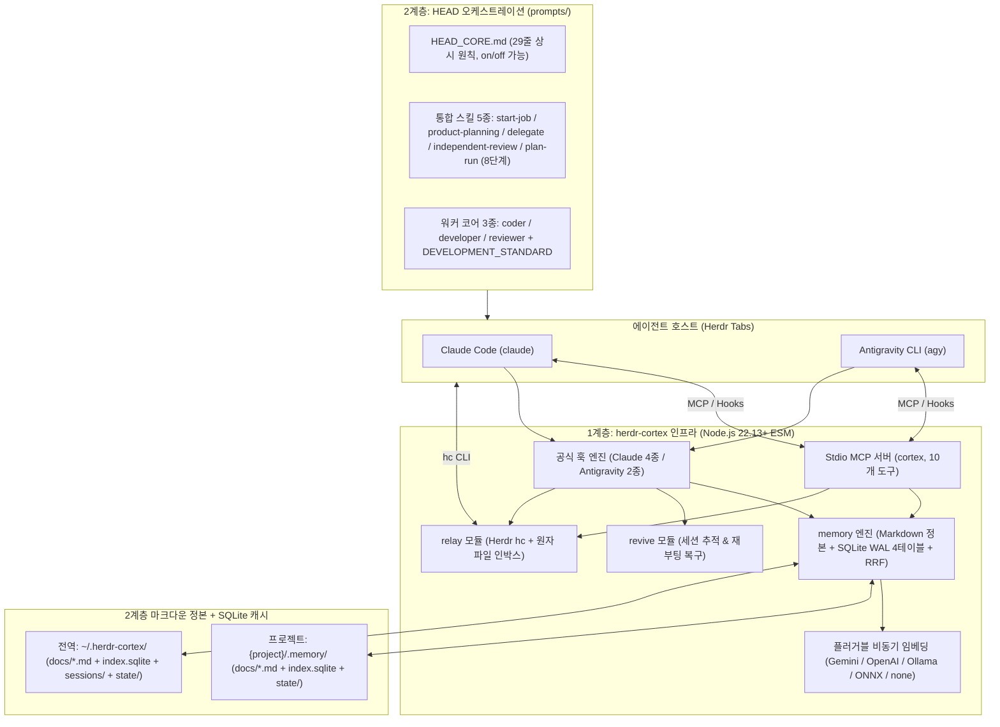

# herdr-cortex

Windows 11 **Herdr Desktop (`herdr-app` + `herdr-core` / `hc`)** 환경에서 **Claude Code (`claude`)**와 **Antigravity CLI (`agy`)**가 함께 쓰는 **2계층 통합 에이전트 코어**입니다.

세션이 길어지거나 PC 재부팅 · `/clear` · 컨텍스트 압축(Compaction) · 멀티 탭 병렬 작업을 거치더라도, **원래의 사용자 합의(Authority)와 프로젝트 기억, 진행 맥락을 잃지 않도록 설계된 장기 기억 + 자동 복구 + 크로스 탭 릴레이 + HEAD 오케스트레이션 시스템**입니다.

---

## 주요 특징 한눈에 보기

| 영역 | 핵심 기능 |
| :--- | :--- |
| **장기 기억 정본** | 2계층 마크다운(`프로젝트 .memory/` + `전역 ~/.herdr-cortex/`) 정본 + `node:sqlite` WAL 4테이블 고속 캐시 (언제든 마크다운에서 100% 재구축) |
| **4박자 하이브리드 검색** | 정형 SQL 푸시다운 + 한국어 안전 FTS5(`trigram` + 1~2자 `LIKE` 폴백 + 조사 보조 토큰) + `sqlite-vec` 벡터 KNN + 1홉 그래프 RRF 2단계 조회 (별도 `memory_graph`는 1~10홉 BFS 지원) |
| **플러거블 비동기 임베딩** | `gemini` · `openai` · `ollama` · `onnx` · `auto` · `none` 지원. 저장 지연 0ms 백그라운드 큐, `content_hash` 벡터 보존, 재시도 상한 & 401/403 서킷브레이커 |
| **공식 훅 자동 복구** | Claude Code / Antigravity CLI 공식 훅만으로 압축·`/clear`·재시작 후 핵심 기억과 최근 5턴 원문을 무절단 예산(`FIT_STEPS`, 기본 9,000자) 내 자동 재주입 |
| **서브에이전트 격리 & 보안** | 메인 HEAD만 정본 쓰기 허용(서브에이전트 읽기 전용 + 부모 세션 덮어쓰기 원천 차단), 전 구간 프로젝트 스코핑(`excludedProjects` / `opt-in`), 프로젝트 설정 화이트리스트 |
| **Herdr 복구 & 탭 릴레이** | 재부팅 후 탭별 세션 자동 복구(`revive-agents`) + 프로젝트 파일 인박스 기반 크로스 탭 메시징(예산 우선 부분 `ack` + 유휴 탭만 `hc send --if idle`) |
| **2계층 HEAD 오케스트레이션** | 29줄 상시 원칙(`HEAD_CORE.md`), 5대 통합 스킬(`plan-run` 8단계 다사이클 포함), 3대 워커 코어(`coder` / `developer` / `reviewer`), 편향 없는 독립 검수 프로토콜 |

---

## 목차

1. [빠른 시작 (Quick Start)](#1-빠른-시작-quick-start)
2. [핵심 철학과 설계 원리](#2-핵심-철학과-설계-원리)
3. [전체 2계층 아키텍처 & 디렉터리 구조](#3-전체-2계층-아키텍처--디렉터리-구조)
4. [1계층 인프라 상세 (기억 · 검색 · 임베딩 · 훅 · 복구 · 릴레이)](#4-1계층-인프라-상세)
5. [2계층 HEAD 오케스트레이션 (`prompts/`)](#5-2계층-head-오케스트레이션-prompts)
6. [MCP 도구 레퍼런스 (`cortex`, 10개)](#6-mcp-도구-레퍼런스-cortex-10개)
7. [설정 및 보안 모델 (프로젝트 스코핑 & 샌드박스)](#7-설정-및-보안-모델)
8. [운영 명령어 · 진단 · 테스트 · 제거](#8-운영-명령어--진단--테스트--제거)
9. [License & Acknowledgments](#9-license--acknowledgments)

---

## 1. 빠른 시작 (Quick Start)

### 요구 사항
* **OS**: Windows 11 + PowerShell (Windows PowerShell 5.1 또는 PowerShell 7+)
* **Node.js**: **v22.13.0 이상** (내장 `node:sqlite` 사용)
* **Herdr-Core (`hc.exe`)**: 선택 사항 (`revive` 및 크로스 탭 `relay` 기능 사용 시 `PATH` 등록 필요)

### 설치 (4단계)
```powershell
git clone https://github.com/ggumtakg/herdr-cortex.git
cd herdr-cortex
npm install
powershell -ExecutionPolicy Bypass -File .\install.ps1
```

설치가 완료되면 기존 사용자 설정은 최초 1회 `.herdr-cortex.bak`으로 안전하게 백업되며, 아래 항목이 멱등(idempotent)하게 등록됩니다:
1. **Antigravity CLI**: `~/.gemini/config/hooks.json` (`SessionStart`, `PreInvocation`), MCP 서버 `cortex` (`~/.gemini/antigravity-cli/mcp_config.json`, `~/.gemini/config/mcp_config.json`)
2. **Claude Code**: `~/.claude/settings.json` (단일 통합 `SessionStart`, `PreCompact`, `UserPromptSubmit`, `PreToolUse`), MCP 서버 `cortex` (`~/.claude.json`), 관리 스킬 (`~/.claude/skills/cortex-*`)
3. **전역 저장소**: `%USERPROFILE%\.herdr-cortex\` (`docs/`, `sessions/`, `config.json`)
4. **PowerShell `$PROFILE`** *(UTF-8 BOM 저장)*: 재부팅 자동 복구 로더 + `cortex-status`, `revive-agents`, `revive-status` 명령어 등록

> 재부팅 시 자동 복구 없이 메모리·릴레이·수동 명령만 사용하려면 `.\install.ps1 -NoAutoResume`로 설치하세요.

### 설치 확인
새 PowerShell 창을 열거나 현재 창에서 프로필을 다시 불러온 뒤 `cortex-status`를 실행합니다.
```powershell
cortex-status
```
Node 버전(`>=22.13`), `sqlite-vec` 로드 상태, 현재 폴더 정책(`enabled`, `excludedProjects`, `hookBudget`, `embed`), 프로젝트/전역 DB 문서·임베딩 분포, Claude/Antigravity 설정 연결 상태가 한 번에 표시됩니다.

---

## 2. 핵심 철학과 설계 원리

### ① "컨텍스트는 기억이 아니다" (Context ≠ Memory)
LLM은 과거를 체화한 동료가 아니라 매 턴 주어진 대본(컨텍스트)만 보고 다음 행동을 결정하는 실행기입니다.
* **창이 크다고 정확해지지 않습니다**: 현재 판단과 무관한 낡은 결정, 세부 로그, 다단계로 재요약된 텍스트는 노이즈가 되어 판단을 흐립니다.
* **1단계 확장 한계**: 사람의 의도에서 한 번 확장한 계획은 정확하지만, 모델이 자기 출력을 다시 요약하고 그 요약을 다음 단계의 전제로 삼기 시작하면 명세 표류(Specification Drift)가 빠르게 누적됩니다.
* **해법**:
  1. 합의된 결정·기준선·작업 기록·할 일은 대화 외부의 **마크다운 정본(Source of Truth)**에 고정합니다.
  2. 압축 직전에는 장문 요약 대신 **1줄 포인터**만 남기고, 압축/`/clear` 직후에는 공식 훅이 **정본 요약 + 직전 5턴 순수 원문**을 자동 재주입합니다.

### ② 해상도 분리(Resolution) · 독립 검수 · 실행 증명
* **HEAD (Control Plane)**: 저·중해상도(목적 합의, 실행 계약 확정, 패키징된 결과 통합, 최종 판정)에 머물러 구현 세부 누적에 의한 시야 협소화(Narrowing)를 예방합니다.
* **Workers (Bounded Owners)**: 고해상도 세부 조사·구현은 격리된 워커(`coder` / `developer`)나 포크·별도 탭에서 수행하고 결과·제약·1차 근거 위치로 압축해 반환합니다.
* **편향 없는 독립 검수**: 직접 작성·구현한 산출물은 같은 컨텍스트가 아닌 **완전히 새로운 독립 컨텍스트(`reviewer` / `independent-review`)**로 검증한 뒤 HEAD가 원래 사용자 합의 기준으로 최종 판정합니다.
* **실제 실행으로 증명 (*Prove it by running it*)**: 보고 텍스트만으로 완료를 선언하지 않고 실제 입력부터 소비 지점까지의 실행 결과로 완료를 입증합니다.

### ③ 정본 보호 (Canon Protection) & 이력 보존
* **서브에이전트 읽기 전용**: 정본 쓰기(`memory_save`, `memory_update`)는 메인 HEAD 대화만 수행합니다. 서브에이전트의 쓰기 시도는 MCP 서버(`SUBAGENT_WRITE_DENIED`)와 Claude `PreToolUse` 훅(`permissionDecision: "deny"`)에서 이중 차단됩니다.
* **삭제 대신 `supersedes` 계보 유지**: 기존 결정이나 기준선이 바뀌면 덮어쓰거나 지우지 않고 새 문서의 `supersedes`로 대체 연결합니다. 이전 문서는 원자적으로 `status: superseded`로 전이되어 **기본 검색에서 제외**되므로 낡은 기억 오도를 막으면서도, 필요할 때 `memory_graph`로 변경 이유와 계보를 추적할 수 있습니다.
* **긍정 행동 중심 상시 원칙**: 상시 주입되는 `HEAD_CORE.md`는 29줄의 긍정 행동 원칙만 유지하고, 결함 판별·금지 체크리스트는 검수 단계로 분리해 컨텍스트 오염을 최소화합니다.

---

## 3. 전체 2계층 아키텍처 & 디렉터리 구조



### 저장소 구조
```text
herdr-cortex/
├── install.ps1 / uninstall.ps1     # Windows 11 멱등 설치/제거기 (Node 버전 검증, UTF-8 BOM 프로필)
├── src/
│   ├── core/                       # 정본 마크다운 파서, SQLite WAL 4테이블, RRF 검색, BFS 그래프, FIT_STEPS 예산
│   ├── embeddings/                 # Gemini / OpenAI / Ollama / ONNX 프로바이더, 비동기 큐, 일괄 임베딩 CLI
│   ├── mcp/                        # Stdio MCP 서버 및 메모리·프롬프트 도구 7종
│   ├── hooks/                      # Claude / Antigravity 공식 훅, 대용량 JSONL tail 추출기, 설정 설치기
│   ├── revive/                     # Herdr 탭 세션 추적기(서브에이전트 가드, /clear 이전 세션 체인)
│   └── relay/                      # Herdr hc 래퍼, 원자 파일 인박스(부분 ack), 릴레이 MCP 도구 3종
├── prompts/                        # HEAD_CORE.md, DEVELOPMENT_STANDARD.md, 5대 스킬(plan-run 01~08), 3대 워커
├── scripts/                        # auto-revive.ps1(cortex-status 포함), revive-agents.ps1, record-session.mjs, merge-hooks.mjs
└── test/                           # 행동·보안·회귀·purity 자동 테스트 (5개 스위트, 47개 테스트)
```

---

## 4. 1계층 인프라 상세

### ① 2계층 마크다운 정본 (파일 1개 = 문서 1개)
* **프로젝트 계층 (`<project>/.memory/docs/YYYY-MM/<id>.md`)**: `decision`, `worklog`, `knowledge`, `todo`, `baseline` 문서를 YAML Frontmatter와 함께 저장합니다. 프로젝트마다 격리되며 Git으로 버전 관리할 수 있습니다.
* **전역 계층 (`%USERPROFILE%\.herdr-cortex\docs\{preferences,knowledge}\`)**: 프로젝트 전반에 걸친 사용자 선호도(`preferences`)와 범용 노하우(`knowledge`)를 저장합니다.
* **지연 읽기(Lazy Read-Only)**: 검색·읽기·개요 조회만 수행할 때는 아직 초기화되지 않은 프로젝트에 `.memory/` 폴더나 DB를 생성하지 않습니다. 실제 프로젝트 쓰기(`memory_save`) 시점에만 초기화됩니다.

### ② SQLite 4테이블 + `index_meta` 하이브리드 검색 (`node:sqlite` + `WAL`)
`index.sqlite`는 언제든 삭제해도 마크다운 원본에서 100% 재구축되는 로컬 인덱스 캐시입니다. `PRAGMA journal_mode = WAL`, `PRAGMA busy_timeout = 5000`, `BEGIN IMMEDIATE` 동기화 트랜잭션으로 다중 탭 동시 접근 충돌을 방지하며, Windows 환경에서 재구축 시 `.sqlite` 본체 삭제가 잠금(`EBUSY`)으로 막히면 `-wal`/`-shm`만 선삭제되어 DB가 손상되지 않도록 안전하게 중단합니다.

| 테이블 | 유형 | 핵심 동작 |
| :--- | :---: | :--- |
| **`docs`** | 정형 (SQL) | 메타데이터(`type`, `status`, `session`, `branch`, `tags`, `due`), 원문, 증분 동기화 키 `(mtime_ms, size, hash, content_hash)`, 임베딩 재시도 상태(`embed_attempts`, `embed_error`) |
| **`docs_fts`** | 키워드 (FTS5) | `trigram` BM25 + `JOIN docs` SQL 메타데이터 필터 푸시다운. **한국어 1~2자 토큰(`압축`, `락`, `훅`)은 자동 `LIKE` 폴백**, 문장부호 제거 및 보수적 조사 어간 보조 토큰으로 검색 누락 보완 |
| **`doc_chunks_vec`** | 벡터 (`sqlite-vec`) | `vec0` 코사인 KNN (`chunk_size=64` 콤팩트 블록 — 50문서 768차원 기준 `< 1MB`). `status`/`type` 푸시다운, `content_hash` 동일 시 기존 벡터 보존, 코사인 거리 컷오프(`<= 0.65`), 미설정 시 무장애 생략 |
| **`edges`** | 그래프 | `links_to`(`[[doc-id]]`), `points_file`, `file_link`, `supersedes`, `derived_from`, `session_next` 통합 엣지. JS BFS **1~10홉** 순환 안전 탐색 + 크로스티어 `exists` 병합 |
| **`index_meta`** | 메타 | 임베딩 프로바이더·모델·차원 원자 저장 (모델 변경 감지 시 `doc_chunks_vec`만 자동 재구축) |

* **2단계 RRF 조회 (토큰 절약)**:
  1. `memory_search`는 정형 필터 + 한국어 키워드 + 지연 쿼리 임베딩(벡터가 0건이면 임베딩 API 미호출) 기반 크로스티어 글로벌 벡터 KNN을 **RRF + 최신성 가중치**로 융합하고, **`id` · `title` · `summary` · 1홉 `relations` 요약만** 반환합니다.
  2. `memory_read`로 정말 필요한 문서 1~3개만 전문 로드합니다.
  3. 벡터 후보는 항상 정본 `docs` 테이블 `WHERE` 조건으로 교차 검증해 `superseded`/`archived` 문서가 섞여 나오지 않도록 차단합니다.

### ③ 플러거블 비동기 임베딩 (`src/embeddings/`)
| 프로바이더 | 기본 모델 / 특징 | 활성화 조건 |
| :--- | :--- | :--- |
| **`gemini`** | `gemini-embedding-001` (768차원), `x-goog-api-key` 헤더, 100건 서브배치, 429/5xx 백오프 | `GEMINI_API_KEY` 또는 `GOOGLE_API_KEY` |
| **`openai`** | `text-embedding-3-small` | `OPENAI_API_KEY` |
| **`ollama`** | `nomic-embed-text` (기본, `search_document:` / `search_query:` 접두어 자동 적용; 다국어 대안 `bge-m3` 지원) | `"provider": "ollama"`(기본 `http://127.0.0.1:11434`), `auto` 모드에서는 `OLLAMA_HOST` 또는 `embedding.baseUrl` 설정 시 |
| **`onnx`** | `Xenova/multilingual-e5-small` (완전 오프라인 로컬 임베딩, `@huggingface/transformers` 지연 로드) | `"provider": "onnx"` 또는 `auto` 모드에서 `onnxEnabled: true` |
| **`auto`** | `gemini` → `openai` → `ollama` → `onnx`(`onnxEnabled: true`일 때만) 순으로 비차단 자동 선택 | 기본값 |
| **`none`** | 벡터 임베딩 비활성화 (정형 + 한국어 FTS5/LIKE + 그래프만 사용) | `"provider": "none"` |

* `memory_save` 시 정형·FTS5·그래프는 즉시 커밋(저장 지연 0ms)하고, 벡터화는 백그라운드 큐가 비동기 처리합니다.
* `superseded`/`archived` 문서는 임베딩에서 제외하며, 실패 재시도 상한(`3회`), 401/403 인증 오류 서킷브레이커, 본문 수정 시 stale hash 가드, MCP 서버 종료 전 `drain(3000)` 대기를 적용했습니다.
* 수동 일괄 처리: `npm run embed -- [--project <dir>] [--global <dir>] [--scope all|project|global] [--provider <name>] [--model <name>] [--max-docs 200]` (남은 문서가 0건이 될 때까지 자동 루프).

### ④ 공식 훅 자동 복구 & 서브에이전트 차단 (`src/hooks/`)
* **Claude Code (`src/hooks/claude.mjs`)**:
  * `SessionStart` *(단일 통합 훅)*: `HEAD_CORE.md` + 수신 인박스 + `memory_overview` + (`/clear`·`compact` 시) 직전 5턴 원문을 9,000자 통합 예산 내 주입. 일반 터미널 `/clear`에서도 같은 디렉터리의 직전 `.jsonl`로 폴백 복구.
  * `PreCompact`: 서브에이전트 스킵 후 1줄 포인터 `systemMessage` 출력.
  * `UserPromptSubmit`: 남은 예산 내에서 인박스 드레인 + 실제 전달된 메시지만 부분 `ack`.
  * `PreToolUse`: 서브에이전트의 쓰기 도구(`memory_save`, `memory_update`, `relay_send`, `relay_inbox(ack)`)를 직접 `permissionDecision: "deny"`로 차단(정상 도구에 불필요한 `allow` 미반환).
* **Antigravity CLI (`src/hooks/antigravity.mjs`)**:
  * **트랜스크립트 16KB 롤 프로브**: 훅 payload에 `rootConversationId`가 없어도 트랜스크립트 앞 16KB의 첫 스텝(`USER_INPUT`/`USER_EXPLICIT` vs `[Message] sender=<부모ID>`)으로 루트 대화와 서브에이전트를 정확히 판별합니다. `SessionStart` 시점에 미확정(`unknown`)이면 `PreInvocation`으로 보류하고, 서브에이전트로 판별되면 주입과 세션 기록을 전면 건너뜁니다.
  * `PreInvocation`: 첫 루트 호출 시 `HEAD_CORE` + `overview` 1회 주입, `/compact` 입력 시 1줄 포인터, `CHECKPOINT(DONE)` 감지 시 1회 자동 복원, 예산 우선 부분 `ack` 인박스 드레인.
* **대용량 JSONL & `FIT_STEPS` 예산 엔진**:
  * 2MB를 초과하는 트랜스크립트 JSONL은 끝부분 2MB만 tail-read해 메모리와 지연을 통제하며, 노이즈 정규식 앵커링·`User has answered` 보존·초대형 단일 턴 앞/뒤 동시 보존을 수행합니다.
  * `FIT_STEPS`는 문장 중간을 자르지 않고 단계별로 압축하며, **`P0` 브랜치 기준선(`p0Baselines`) · 활성 세션 · 열린 할 일 · 핵심 결정**을 끝까지 보호합니다.

### ⑤ `revive` & Herdr `relay` (`src/revive/`, `src/relay/`)
* **`revive`**: Herdr 탭(`HC_TERMINAL_ID`)별 `agy`/`claude` 세션 ID를 `~/.herdr-cortex/sessions/<terminalId>.json`에 기록합니다. 엄격한 ID 정규식 검증으로 명령 주입을 방지하고, 서브에이전트가 부모 세션을 덮어쓰지 못하게 막으며 `/clear` 이전 `previousSessionId` 이력을 보관합니다.
* **`relay`**: `hc ls --json` / `hc get`으로 탭의 실제 상태(`idle`/`busy`/`blocked`/`error`/`done`/`isBareShell`, `foreground.cwd`)를 판별합니다. 메시지 전문은 수신 탭 프로젝트의 `.memory/state/inbox/<terminalId>/`에 원자 저장(`.taking-<pid>` claim + 예산 내 전달분만 부분 `ack` + 복원 실패 시 디렉터리 보존 + 크래시 복구 + `.broken/` 격리 + Windows 파일 락 재시도)하고, 빈 셸이나 오류 상태가 아닌 유휴 에이전트 탭에만 `hc send --if idle`로 짧은 1줄 깨우기 트리거를 전송합니다.

---

## 5. 2계층 HEAD 오케스트레이션 (`prompts/`)

| 자산 | 경로 | 역할 |
| :--- | :--- | :--- |
| **`HEAD_CORE.md`** | `prompts/HEAD_CORE.md` | 29줄 상시 원칙: 해상도 분리, 시야 협소화 예방, 관측/추론 분리, 독립 검수 의무, 실행 증명, 정본 보호 |
| **`DEVELOPMENT_STANDARD.md`** | `prompts/DEVELOPMENT_STANDARD.md` | 구현·리뷰 공통 7원칙 (과잉설계·커버리지 집착 배제, 발견 없음 = 정상 리뷰) |
| **`start-job`** | `prompts/skills/start-job/SKILL.md` | 진입 게이트: 목표 합의 → 기억 우선 탐색 → 직접 처리 / 포크 / `delegate` / `plan-run` 라우팅 |
| **`product-planning`** | `prompts/skills/product-planning/SKILL.md` | 문제 정의 → 사용자 가치 → 유저플로우(자동화 vs 사용자 통제 경계) 3단계 기획 |
| **`delegate`** | `prompts/skills/delegate/SKILL.md` | 1회성 경계 위임 (작업 유형 혼합 금지 + Entry Contract 5요소 + 워커 역할 로드 + 패키징 재통합) |
| **`independent-review`** | `prompts/skills/independent-review/SKILL.md` | 새 컨텍스트 독립 검수 — **`Verified Facts` / `Open Facts` / `Blockers` / `Minor Notes` / `Verdict`** 5구획 통일 출력 |
| **`plan-run` (8단계)** | `prompts/skills/plan-run/` (`steps/01~08.md`) | 호스트 중립 다사이클 자율 파이프라인: `P0`(최초 목적, `overview` 보호) → 사이클별 `C{k}-IDEATION` / `C{k}-PLAN` / `C{k}-PN` / `C{k}-R{k}` / `C{k}-SEED` 브랜치 + `derived_from` 계보(`depth: 8`), 4단계(`04-plan-acceptance`)의 3단계 출력 격리, `LOCAL_CORRECTION` 재시도 상한(`attempt: N/2`), 최종 `DONE` 시 HEAD가 중간 기준선을 `memory_update(status: "archived" / "done")`로 마감 |
| **워커 코어 3종** | `prompts/agents/{coder,developer,reviewer}.md` | `coder`(확정 명세 구현, `contract_conflict` 보고) · `developer`(경계 내 E2E 구현+실행 증명) · `reviewer`(수정 권한 0 독립 비평가) |

---

## 6. MCP 도구 레퍼런스 (`cortex`, 10개)

| 도구 | 분류 | 권한 | 설명 |
| :--- | :---: | :---: | :--- |
| `memory_search` | 메모리 | 읽기 | 1단계 RRF 하이브리드 검색 (`query`, `type`, `session`, `branch`, `file`, `scope`, `include_superseded`, `limit` → 요약 + 1홉 관계) |
| `memory_read` | 메모리 | 읽기 | 2단계 문서 전문 + 선택적 1홉 이웃 그래프 로드 (`id`, `scope`, `include_neighbors`) |
| `memory_save` | 메모리 | **HEAD 전용** | 마크다운 정본 생성, `supersedes` 전이(대상 미존재·타 스코프 불일치 시 경고), 프로젝트 내부 절대경로 `files` 자동 상대화, `derived_from` 배열 링크, 즉시 색인 + 비동기 임베딩 |
| `memory_update` | 메모리 | **HEAD 전용** | 기존 문서 상태·본문·태그·파일·계보 갱신 (`append_content` 지원) |
| `memory_graph` | 메모리 | 읽기 | 1~10홉 BFS 그래프 탐색, `file:<상대경로>` 영향도(`impact`), `plan-run` 다사이클 계보 추적 |
| `memory_overview` | 메모리 | 읽기 | 보호된 `P0` 기준선, 활성 세션/브랜치, 열린 할 일, 최근 결정/기준선, 전역 선호도 요약 |
| `relay_tabs` | 릴레이 | 읽기 | `hc ls` + 저장 세션 + 프로젝트 세션 매핑 + 인박스 대기 수 통합 조회 |
| `relay_send` | 릴레이 | **HEAD 전용** | 수신 프로젝트 인박스 원자 저장 + 유휴 시 `hc send --if idle` 1줄 트리거 (`wake: auto \| always \| never`) |
| `relay_inbox` | 릴레이 | 읽기 / **HEAD 확인** | 현재 탭 수신 메시지 조회(`action="peek"`) 또는 확인(`action="ack"`, HEAD 전용) |
| `cortex_prompt` | 오케스트레이션 | 읽기 | `core`, `standard`, `skill`, `agent` 프롬프트 자산 안전 로드(경로 탈출 차단) |

> 모든 `memory_*` 도구(6종)는 선택적 `project_dir` 인자를 지원하며, MCP 서버는 `notifications/roots/list_changed` 알림을 오류 없이 정상 수신합니다.

---

## 7. 설정 및 보안 모델

### 전역 설정 (`%USERPROFILE%\.herdr-cortex\config.json`)
```json
{
  "mode": "all",
  "enabledProjects": [],
  "excludedProjects": ["legacy-repo-name"],
  "headCoreEnabled": true,
  "hookBudget": 9000,
  "embedding": {
    "provider": "auto",
    "model": "",
    "dimensions": 0,
    "baseUrl": "",
    "apiKeyEnv": "",
    "onnxEnabled": false,
    "chunkMaxChars": 800,
    "chunkOverlap": 100,
    "timeoutMs": 15000
  }
}
```

### 전 구간 프로젝트 스코핑 (`mode` / `excludedProjects` / `enabledProjects`)
* **`mode: "all"` (기본)**: `excludedProjects`에 일치하는 폴더명 또는 경로 접두어를 제외한 모든 프로젝트에서 활성화됩니다.
* **`mode: "opt-in"`**: `enabledProjects`에 명시된 프로젝트에서만 활성화됩니다.
* 제외된 프로젝트에서는 **훅 · MCP 서버 · `relay` · `npm run embed` CLI 전 구간**에서 프로젝트 메모리 읽기/쓰기 및 `.memory/` 생성이 차단되며(`PROJECT_EXCLUDED`), 전역(`scope="global"`) 기억과 `revive` 세션 추적은 독립적으로 안전하게 유지됩니다.

### 프로젝트 `.memory/config.json` 보안 화이트리스트
신뢰할 수 없는 외부 저장소를 열었을 때의 설정 악용(SSRF, API 키 탈취, 전역 제외 정책 우회)을 막기 위해, 프로젝트 내부 `.memory/config.json`에서는 **안전한 비네트워크·비인증 항목만 화이트리스트로 허용**합니다:
* **허용**: `headCoreEnabled`, `hookBudget`, `enabled: false`(비활성화만 허용), `embedding.{provider, model, dimensions, chunkMaxChars, chunkOverlap, timeoutMs}`
* **차단(무시)**: `embedding.{baseUrl, apiKey, apiKeyEnv, onnxEnabled}`, `mode`, `enabledProjects`, `excludedProjects`, `enabled: true`

### 임베딩 빠른 설정
* **Gemini 자동 활성화**: Windows 사용자 환경변수에 `GEMINI_API_KEY`(또는 `GOOGLE_API_KEY`) 등록 → `"provider": "auto"`에서 `gemini-embedding-001` 자동 사용.
* **완전 오프라인 Ollama**: `ollama pull nomic-embed-text` 후 `"provider": "ollama"` (다국어 모델 사용 시 `ollama pull bge-m3` 후 `"provider": "ollama", "model": "bge-m3"`).
* **완전 오프라인 ONNX**: `npm install @huggingface/transformers` 후 `"provider": "onnx"` (또는 `auto` 모드에서 `"onnxEnabled": true`).

---

## 8. 운영 명령어 · 진단 · 테스트 · 제거

### PowerShell 운영 명령어
```powershell
cortex-status          # Node 버전, sqlite-vec, CWD 스코핑 정책, 프로젝트/전역 DB·임베딩 분포, 훅/MCP 설정, 인박스/.broken 진단
revive-agents          # 빈 셸 상태인 모든 Antigravity / Claude Herdr 탭 일괄 복구
revive-agents -DryRun  # 실제 실행 없이 복구 대상과 명령어 미리 보기
revive-status          # 열린 Herdr 터미널 상태 및 저장된 세션 ID 확인
```

### npm 스크립트 및 테스트
```powershell
npm test               # 전체 47개 자동 테스트 실행 (DB/보안/검색/임베딩/훅/릴레이/오케스트레이션/purity)
npm run embed          # 미임베딩 문서 일괄 임베딩 (남은 문서 0건까지 자동 반복)
npm run mcp            # cortex Stdio MCP 서버 직접 실행
```

### 제거
```powershell
# 훅 · MCP · 스킬 · PowerShell 프로필 블록만 깔끔하게 제거 (기존 사용자 설정 및 데이터 보존)
powershell -ExecutionPolicy Bypass -File .\uninstall.ps1

# ~/.herdr-cortex 전역 저장소까지 함께 삭제하려면 (-PurgeSessions 별칭도 동일 동작)
powershell -ExecutionPolicy Bypass -File .\uninstall.ps1 -PurgeData
```

---

## 9. License & Acknowledgments

* 이 프로젝트(`herdr-cortex`)는 **[MIT License](LICENSE)**로 배포됩니다.
* 이 프로젝트의 핵심 철학과 설계 원리(HEAD 제어 평면과 해상도 분리, 컨텍스트 관리 및 정본 우선 원칙, 독립 검수, `plan-run` 다단계 기준선 계보, 워커 역할 경계, 마크다운 정본 + SQLite 그래프 캐시 하이브리드 모델)는 **[Won6314/head-agent-core](https://github.com/Won6314/head-agent-core)**에서 영감을 받아 참고·차용하고, Windows 11 + Herdr(`hc`) + SQLite 4테이블(정형 · 한국어 FTS5 · 플러거블 벡터 · 그래프) + 공식 훅/릴레이 환경에 맞춰 재설계·확장한 구현입니다. 원 저작자(Won6314)의 설계와 공개에 감사드립니다.
