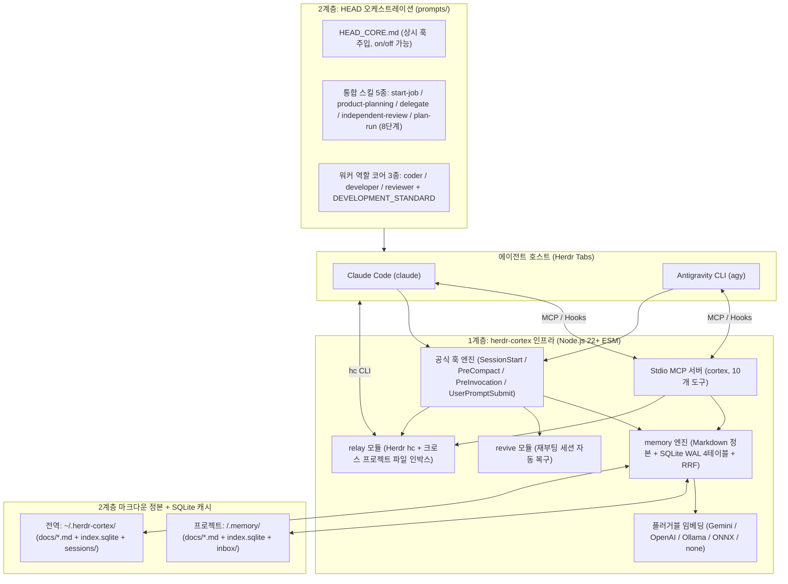

# herdr-cortex

Windows 11 **Herdr Desktop (`herdr-app` + `herdr-core` / `hc`)** 환경에서 **Claude Code (`claude`)**와 **Antigravity CLI (`agy`)**가 공유하는 **2계층 통합 에이전트 코어**입니다.

단순한 메모 저장소가 아니라, **LLM 세션이 길어지거나 재부팅 · `/clear` · 압축(Compaction) · 멀티 탭 전환을 거치더라도 원래의 사용자 합의(Authority)와 작업 맥락을 잃지 않도록 설계된 장기 기억 + 자동 복구 + HEAD 오케스트레이션 시스템**입니다.

---

## 1. 핵심 철학과 설계 원리

### ① "컨텍스트는 기억이 아니다" (Context ≠ Memory)
LLM은 프로젝트 경험을 체화한 동료가 아니라, 매 턴 주어진 대본(현재 컨텍스트)만 보고 다음 장면을 연기하는 배우입니다.
* **창이 크다고 지능이 오르지 않습니다**: 현재 판단과 무관한 사실, 낡은 결정, 급조된 압축 요약은 정보량이 아니라 **노이즈**로 작용해 모델의 판단을 흐립니다.
* **1단계 확장 한계**: 사람의 말에서 한 번 확장한 계획은 잘 작동하지만, 모델이 자기 출력을 다시 요약하고 그 요약을 다음 단계의 전제로 삼는 순간 복합 오류(Specification Drift)가 빠르게 누적됩니다.
* **해법**:
  1. 대화 외부의 **마크다운 정본(Source of Truth)**에 결정·작업기록·할 일·기준선을 저장합니다.
  2. 압축 직전에는 손실이 큰 장문 요약 대신 **1줄 포인터**만 남기고, 압축/`/clear` 직후에는 **정본 요약 + 직전 5턴 순수 원문**을 훅으로 자동 재주입합니다.
  3. 컨텍스트 넣고 빼기 통제는 프롬프트에만 맡기지 않고 **외부 인프라(공식 훅 + 예산 축약 엔진 + MCP 도구)**가 담당합니다.

### ② 해상도 분리(Resolution) & 독립 검수 원칙
고해상도 구현 디테일이 메인 대화에 쌓일수록 모델의 시야가 좁아져(Narrowing) 최초의 사용자 목적을 놓칩니다.
* **HEAD (Control Plane)**: 저·중해상도(사용자 목적 합의 · 작업 계약 · 결과 패키징 통합 · 최종 판정)에 머뭅니다.
* **Workers (One-shot Bounded Owners)**: 고해상도 세부 구현은 `developer` / `coder` 워커나 포크로 격리합니다.
* **독립 검수 (Anti Self-Confirming Bias)**: **자기 산출물의 검수는 절대 같은 컨텍스트나 포크에서 하지 않고**, 제작 편향이 없는 **완전히 새로운 독립 컨텍스트(`reviewer` / `independent-review`)**에 1차 근거만 넘겨 검증한 뒤 HEAD가 원래 목적 기준으로 최종 판정합니다.
* **실행 증명 (*Prove it by running it*)**: 워커 보고서나 리뷰 텍스트만으로 완료를 선언하지 않고, 실제 주 경로 실행 결과를 근거로 확인합니다.

### ③ 정본 보호 정책 (Canon Protection)
* **서브에이전트 읽기 전용**: 메인 대화(HEAD)만 `memory_save` / `memory_update`를 호출할 수 있으며, 서브에이전트(`agent_id` 또는 `conversation_id !== root_conversation_id`)의 쓰기 시도는 런타임에서 **`SUBAGENT_WRITE_DENIED`**로 차단됩니다.
* **삭제 대신 `superseded` 계보 보존**: 기존 결정을 뒤집을 때 문서를 덮어쓰거나 지우지 않고, 새 결정이 옛 결정을 `supersedes`하도록 기록합니다. 옛 문서는 자동으로 `status: superseded`로 전이되어 **기본 검색에서 제외**되므로 낡은 기억 오도를 막으면서도, 필요 시 "왜 바꿨는지" 의사결정 이력을 그래프로 추적할 수 있습니다.
* **금지문(Deny List) 배제**: 상시 주입되는 `HEAD_CORE.md`는 약 30줄의 긍정적 행동 원칙만 담고, 상세 금지·점검 기준은 검수 단계로 분리해 컨텍스트 오염을 최소화합니다.

---

## 2. 전체 2계층 아키텍처



---

## 3. 1계층 상세 원리: 기억 · 검색 · 복구 · 릴레이

### ① 2계층 마크다운 정본 (파일 1개 = 문서 1개)
* **프로젝트 계층 (`<project>/.memory/docs/YYYY-MM/<id>.md`)**: 프로젝트별 `decision` · `worklog` · `knowledge` · `todo` · `baseline` 문서를 YAML Frontmatter와 함께 저장합니다. 프로젝트마다 완전히 격리되며 Git으로 버전 관리할 수 있습니다.
* **전역 계층 (`%USERPROFILE%\.herdr-cortex\docs\{preferences,knowledge}\`)**: 프로젝트 전반에 걸친 사용자 선호도와 범용 노하우를 저장합니다.
* **파일 1개 = 문서 1개 방식의 이점**: 하나의 거대한 누적 로그 파일(`history.md`)과 달리 수정된 문서 1개만 증분 재색인·임베딩할 수 있고, Git 충돌이 적으며 사람도 에디터/옵시디언에서 바로 읽고 수정할 수 있습니다.

### ② SQLite 4테이블 하이브리드 검색 (`node:sqlite` + `WAL`)
`index.sqlite`는 언제든 지워도 마크다운 원본에서 100% 재구축되는 고속 로컬 캐시입니다. `PRAGMA busy_timeout = 5000` + `PRAGMA journal_mode = WAL`로 다중 탭의 동시 읽기/쓰기 경합을 해소했습니다.

| 테이블 | 유형 | 역할 |
| :--- | :---: | :--- |
| **`docs`** | 정형(SQL) | 메타데이터(`type`, `status`, `session`, `branch`, `tags`, `due`), 원문 `content`, 증분 동기화용 `(mtime_ms, size, hash)`, 임베딩 상태 |
| **`docs_fts`** | 키워드(FTS5) | `tokenize='trigram'` 전문 검색(BM25). **한국어 1~2자 토큰(`압축`, `락`, `훅`)의 trigram 누락 엣지케이스는 자동 `LIKE` 폴백으로 보완** |
| **`doc_chunks_vec`** | 벡터(`sqlite-vec`) | `vec0` 코사인 유사도 검색 (`PARTITION KEY`로 문서 단위 원자 삭제, `+heading`/`+snippet` 내장). 미설정·오프라인 시 무장애 자동 생략 |
| **`edges`** | 그래프 | `links_to`(`[[doc-id]]`), `points_file`, `file_link`, `supersedes`, `derived_from`, `session_next` 통합 엣지 (`WITH RECURSIVE` 1~3홉 탐색) |

* **4박자 RRF 2단계 조회 (토큰 절약)**:
  1. **1단계 (`memory_search`)**: 정형 필터(`superseded`/`archived` 기본 제외) + 한국어 키워드 + 벡터 KNN을 **RRF(Reciprocal Rank Fusion)** + 최신성 가중치로 융합하고 1홉 연관 엣지를 붙여 **`id`, `title`, `summary`, `relations` 목록만** 반환합니다.
  2. **2단계 (`memory_read`)**: LLM이 목록에서 정말 필요한 문서 1~3개만 지정해 전문을 로드합니다.

### ③ 플러거블 비동기 임베딩 (`src/embeddings/`)
* **지원 프로바이더**: `gemini` (`gemini-embedding-001`, 768차원) · `openai` (`text-embedding-3-small`) · `ollama` (`bge-m3`) · 로컬 `onnx` (`@huggingface/transformers` 지연 로드) · `auto` · `none`
* **저장 지연 0ms**: `memory_save` 시 정형·FTS5·그래프만 10~30ms 안에 즉시 커밋하고, 벡터 임베딩은 비동기 백그라운드 큐(또는 `npm run embed`)가 처리합니다.
* **모델 교체 자동 대응**: 프로바이더/차원이 바뀌면 `index-meta.json`으로 감지해 `doc_chunks_vec`만 마크다운 정본에서 자동 재구축합니다.

### ④ 공식 훅 자동 복구 · `revive` · Herdr `relay`
* **공식 훅만 사용 (비공개 소켓/로그 해킹 배제)**:
  * **Claude Code**: `SessionStart`(9,000자 상한 대응 `core`/`context` 분할, `/clear`·`compact` 시 직전 5턴 원문 및 `previousSessionId.jsonl` 복원), `PreCompact`(1줄 포인터), `UserPromptSubmit`(인박스 드레인), `PreToolUse`(서브에이전트 스푸핑 방어)
  * **Antigravity CLI**: `SessionStart`, `PreInvocation`(`/compact` 1줄 포인터, `transcript_full.jsonl`의 `CHECKPOINT` 완료 감지 시 1회 자동 복원, 인박스 드레인)
  * **`FIT_STEPS` 무절단 축약**: 훅 예산(기본 9,000자) 초과 시 문장 중간을 자르지 않고 단계별로 축약하며 열린 세션·할 일·핵심 결정을 끝까지 보존합니다.
* **프로젝트별 스코핑 (`mode` / `excludedProjects` / `enabledProjects`)**: 특정 프로젝트만 제외(`excludedProjects`)하거나 지정 프로젝트에만 켜는(`opt-in`) 안전 모드를 지원합니다. 제외된 프로젝트에서는 `HEAD_CORE`/맥락 주입과 `.memory/` 생성을 완전 차단하면서 기존 `revive` 세션 추적만 조용히 유지합니다.
* **`revive` (재부팅 세션 복구)**: Herdr 탭(`HC_TERMINAL_ID`)별 `agy`/`claude` 대화 ID를 기록하되, **서브에이전트 가드**로 하위 에이전트가 부모 탭의 세션 ID를 덮어쓰지 못하게 막고 `/clear` 이전 `previousSessionId` 체인을 보관합니다.
* **`relay` (Herdr 크로스 탭 메시징)**: `hc ls --json` / `hc get`으로 살아 있는 탭을 조회하고, 메시지 원문은 대상 탭 프로젝트의 `.memory/state/inbox/<terminalId>/`에 원자 저장(`.taking-<pid>` claim/ack + 크래시 복구 + `.broken/` 격리)한 뒤, 대상 탭이 유휴 상태일 때만 `hc send`로 짧은 1줄 깨우기 트리거를 보냅니다.

---

## 4. 2계층 상세 원리: 풀 HEAD 오케스트레이션 (`prompts/`)

| 자산 | 위치 | 역할 |
| :--- | :--- | :--- |
| **`HEAD_CORE.md`** | `prompts/HEAD_CORE.md` | 상시 주입 원칙(30줄): 해상도 분리, 독립 검수, 실제 실행 증명, 기억 우선 탐색 |
| **`DEVELOPMENT_STANDARD.md`** | `prompts/DEVELOPMENT_STANDARD.md` | 구현·리뷰 공통 7원칙 (오버엔지니어링·커버리지 집착 방지, 발견 없음=정상 리뷰) |
| **`start-job`** | `prompts/skills/start-job/SKILL.md` | 진입 게이트: 목표 합의 → 기억 우선 탐색 → 직접 / 포크 / `delegate` / `plan-run` 라우팅 |
| **`product-planning`** | `prompts/skills/product-planning/SKILL.md` | 문제 정의 → 사용자 가치 → 유저플로우(자동화 vs 사용자 통제 경계) 3단계 기획 |
| **`delegate`** | `prompts/skills/delegate/SKILL.md` | 1회성 경계 위임 (작업 종류 혼합 금지 + Entry Contract 5요소 + 워커 로딩 + 재통합) |
| **`independent-review`** | `prompts/skills/independent-review/SKILL.md` | 제작 편향 없는 새 컨텍스트 독립 검수 (`ACCEPT` / `NEEDS_FIX`) |
| **`plan-run` (8단계)** | `prompts/skills/plan-run/` (`steps/01~08.md`) | **호스트 중립 다단계 자율 파이프라인**: `P0`(최초 목적) → `01` Ideation → `02` 실행 계획 → `03` `P0` 최소성 독립 점검 → `04` 독립 계획 수용(`PN`) → `05` 실행(`Rn`) → `06` `PN` 독립 결과 검수 → `07` `P0` 전체 방향 점검 → `08` HEAD 최종 판정. 각 기준선을 `.memory/docs/` `type: baseline` + `derived_from` 그래프로 영속화해 Claude·Antigravity 양쪽에서 동일 동작 |
| **워커 3종** | `prompts/agents/{coder,developer,reviewer}.md` | `coder`(확정 명세 번역, `contract_conflict` 거절) · `developer`(경계 내 E2E 구현+증명) · `reviewer`(수정 권한 0 독립 비평가) |

---

## 5. MCP 도구 (`cortex`, 총 10개)

| 도구 | 분류 | 권한 | 설명 |
| :--- | :---: | :---: | :--- |
| `memory_search` | 메모리 | 읽기 | 1단계 RRF 하이브리드 검색 (요약 목록 + 1홉 관계만 반환) |
| `memory_read` | 메모리 | 읽기 | 2단계 문서 전문 + 1홉 이웃 그래프 로드 |
| `memory_save` | 메모리 | **HEAD 전용** | 마크다운 정본 생성, `supersedes` 전이, 즉시 색인 + 비동기 임베딩 |
| `memory_update` | 메모리 | **HEAD 전용** | 기존 문서 상태/본문/태그/파일 갱신 |
| `memory_graph` | 메모리 | 읽기 | 1~3홉 그래프 탐색, `file:<경로>` 영향도(`impact`), `plan-run` 계보 추적 |
| `memory_overview` | 메모리 | 읽기 | 활성 세션/브랜치, 열린 할 일, 최근 결정/기준선, 전역 선호도 요약 |
| `relay_tabs` | 릴레이 | 읽기 | `hc ls` + 저장 세션 + 인박스 대기 수 통합 탭 목록 |
| `relay_send` | 릴레이 | 쓰기 | 타깃 프로젝트 인박스 원자 저장 + 유휴 시 `hc send` 단선 트리거 |
| `relay_inbox` | 릴레이 | 읽기/확인 | 현재 탭 수신 메시지 조회(`peek`) / 확인(`ack`) |
| `cortex_prompt` | 오케스트레이션 | 읽기 | `HEAD_CORE`, `DEVELOPMENT_STANDARD`, 5대 스킬, `plan-run` 01~08 스텝, 3대 워커 안전 로드 |

---

## 6. 요구 사항 및 설치

### 요구 사항
* Windows 11 + PowerShell
* **Node.js 22.13+** (내장 `node:sqlite` 사용)
* **Herdr-Core (`hc.exe`)** — `revive` 및 `relay` 사용 시 PATH 등록 필요

### 설치
```powershell
git clone https://github.com/ggumtakg/herdr-cortex.git
cd herdr-cortex
npm install
powershell -ExecutionPolicy Bypass -File .\install.ps1
```

기존 설정은 최초 1회 `.herdr-cortex.bak`으로 백업·보존되며 아래 항목이 등록됩니다:
1. **Antigravity CLI**: `~/.gemini/config/hooks.json` (`SessionStart`, `PreInvocation`), MCP `cortex` (`~/.gemini/antigravity-cli/mcp_config.json`)
2. **Claude Code**: `~/.claude/settings.json` (4종 훅), MCP `cortex` (`~/.claude.json`), 관리 스킬 (`~/.claude/skills/cortex-*`)
3. **PowerShell `$PROFILE`**: 재부팅 자동 복구 + `revive-agents`, `revive-status`, `cortex-status`

> 자동 재부팅 복구 없이 메모리·릴레이·수동 명령만 쓰려면: `.\install.ps1 -NoAutoResume`

---

## 7. 설정 (`%USERPROFILE%\.herdr-cortex\config.json`)

```json
{
  "mode": "all",
  "enabledProjects": [],
  "excludedProjects": ["my-legacy-project"],
  "headCoreEnabled": true,
  "hookBudget": 9000,
  "embedding": {
    "provider": "auto",
    "model": "",
    "dimensions": 0,
    "baseUrl": "",
    "apiKeyEnv": "",
    "chunkMaxChars": 800,
    "chunkOverlap": 100,
    "timeoutMs": 15000
  }
}
```

* **Gemini 벡터 임베딩 활성화**: Windows 사용자 환경변수에 기존 Gemini API 키(`GEMINI_API_KEY` 또는 `GOOGLE_API_KEY`)를 등록하면 `"provider": "auto"`에서 `gemini-embedding-001`(768차원)이 자동 활성화됩니다.
* **완전 오프라인 로컬 임베딩**:
  * Ollama: `ollama pull bge-m3` 후 `"provider": "ollama"`
  * 로컬 ONNX: `npm install @huggingface/transformers` 후 `"provider": "onnx"`
* **수동 일괄 임베딩**: `npm run embed`

---

## 8. 명령어 · 테스트 · 제거

```powershell
# PowerShell 명령어
revive-agents          # 빈 셸 상태인 모든 Antigravity / Claude 탭 일괄 복구
revive-agents -DryRun  # 복구 대상과 명령어 미리 보기
revive-status          # 열린 Herdr 터미널 및 저장된 세션 ID 확인
cortex-status          # 전역/프로젝트 herdr-cortex 상태 확인

# 테스트 실행 (행동 · 회귀 · purity 테스트)
npm test

# 제거 (기존 사용자 설정 보존, -PurgeData 추가 시 저장소까지 삭제)
powershell -ExecutionPolicy Bypass -File .\uninstall.ps1
```

---

## 9. License & Acknowledgments

* 이 프로젝트(`herdr-cortex`)는 **[MIT License](LICENSE)**로 배포됩니다.
* 이 프로젝트의 핵심 철학과 설계 원리(HEAD 제어 평면과 해상도 분리, 컨텍스트 관리 및 정본 우선 원칙, 독립 검수, `plan-run` 다단계 기준선 계보, 워커 역할 경계, 마크다운 정본 + SQLite 그래프 캐시 하이브리드 모델)는 **[Won6314/head-agent-core](https://github.com/Won6314/head-agent-core)**에서 영감을 받아 참고·차용하고, Windows 11 + Herdr(`hc`) + SQLite 4테이블(정형·한국어 FTS5·플러거블 벡터·그래프) 환경에 맞춰 재설계·확장한 구현입니다. 원 저작자(Won6314)의 설계와 공개에 감사드립니다.
