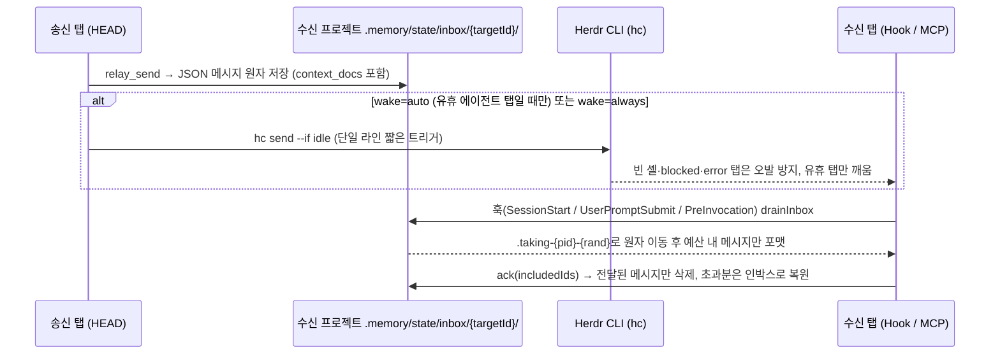

# `src/relay/` — Herdr 크로스 탭 메시징 & 원자 파일 인박스

> [← 루트 README](../../README.md)

Herdr Desktop에서 열려 있는 여러 Claude Code / Antigravity CLI 탭 간에 **안전하게 긴 메시지·참조 기억(`context_docs`)을 주고받기 위한 크로스 탭 릴레이 모듈**입니다. 메시지 본문은 파일 인박스에 원자 저장하고, Herdr CLI(`hc`)로는 짧은 1줄 깨우기 트리거만 전송해 터미널 깨짐과 메시지 유실을 동시에 방지합니다.

---

## 파일 구성

| 파일 | 역할 | 주요 Export |
| :--- | :--- | :--- |
| **`hc.mjs`** | `hc.exe` (`hc ls --json`, `hc get`, `hc send --if idle`) 안전한 래퍼, 탭 상태 판별(`idle`/`busy`/`blocked`/`error`/`done`/`isBareShell`), `foreground.cwd` 파싱, 단선 트리거 정규화 | `MAX_WAKE_TRIGGER_CHARS`, `sanitizeSingleLineTrigger`, `detectTerminalActivity`, `createHcClient` |
| **`inbox.mjs`** | 수신 프로젝트 `.memory/state/inbox/<terminalId>/` 원자 enqueue · `.taking-<pid>-<rand>` claim · 부분 `ack` · 복원 실패 보호 · 크래시 복구 · `.broken/` 격리 · Windows 파일 락 재시도 | `defaultIsPidAlive`, `getTerminalInboxDir`, `enqueueMessage`, `drainInbox`, `peekInbox`, `ackMessage`, `formatInboxForHookDetailed`, `formatInboxForHook` |
| **`tools.mjs`** | MCP 릴레이 도구 3종(`relay_tabs`, `relay_send`, `relay_inbox`) 생성 및 HEAD 쓰기 권한·제외 프로젝트 정책 적용 | `createRelayTools` |

---

## 메시지 전달 & 유실 방지 흐름

* **복원 실패 보호**: 부분 `ack` 중 예산 초과 메시지의 인박스 복원이 실패(`restoreFailed > 0`)하면 `.taking-*` 디렉터리를 삭제하지 않고 남겨 다음 consumer의 stale recovery가 회수할 수 있게 보호합니다.
* **손상 파일 격리**: 파싱 불가능한 JSON 파일은 `.broken/` 디렉터리로 격리해 정상 메시지 처리를 막지 않습니다.
* **권한 보호**: `relay_send`와 `relay_inbox(action="ack")`는 메인 HEAD만 호출할 수 있으며, 서브에이전트는 `relay_tabs` 및 `relay_inbox(action="peek")` 읽기만 허용됩니다.

---

## 관련 테스트
* [`test/relay-inbox.test.mjs`](../../test/relay-inbox.test.mjs)
